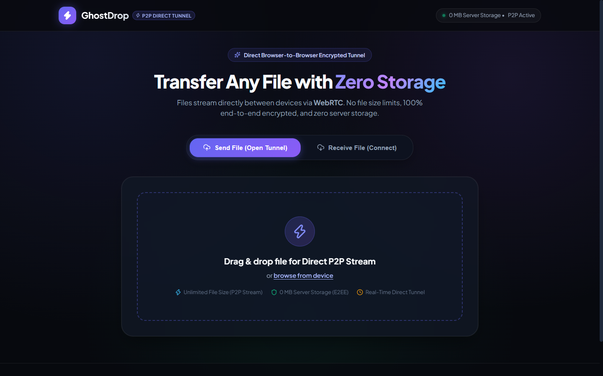
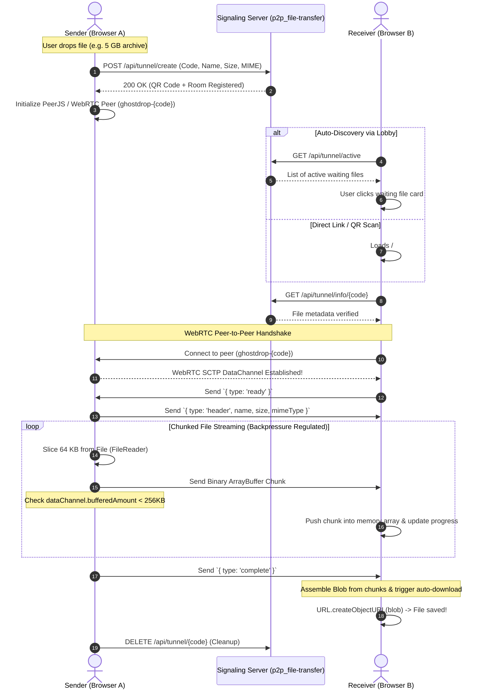

# ⚡ GhostDrop — P2P File Transfer (Frontend)

<div align="center">

[](https://vitejs.dev/)
[](https://react.dev/)
[](https://webrtc.org/)
[](https://peerjs.com/)
[](https://opensource.org/licenses/MIT)
[](https://vercel.com/)
[](../p2p_file-transfer)

<br />


### *Direct Browser-to-Browser Encrypted Streaming • Zero Cloud Storage • Unlimited File Size*

</div>

---

## ?? Application Screenshot & Interface Preview

<div align="center">
  
</div>

---

## 📌 Companion Repositories

> **Note:** **GhostDrop** is an end-to-end distributed system composed of two symbiotic repositories:
> - **Frontend Web Client (This Repo):** [`fshare`](https://github.com/your-username/fshare) — Pure client-side streaming engine, backpressure flow controller, and modern responsive UI.
> - **Signaling & Tunneling Backend:** [`p2p_file-transfer`](../p2p_file-transfer) — Lightweight Express/Vercel serverless matchmaking coordinator for SDP and ICE exchange (`https://p2p-file-transfer-two.vercel.app`).

---

## 📖 Executive Summary & Problem Solved

Traditional cloud file transfers (e.g., WeTransfer, Google Drive, Dropbox, email attachments) suffer from fundamental architectural bottlenecks:
1. **Compromised Privacy & Data Persistence:** Files sit unencrypted on third-party physical disks and cloud buckets.
2. **Double Bandwidth & Latency Tax:** A 10 GB file must upload entirely to a cloud server before the recipient can even begin downloading.
3. **Arbitrary File Size Caps:** Users are restricted to 2 GB quotas or forced into expensive recurring subscriptions.
4. **Server Storage Bills:** Infrastructure hosts pay massive cloud egress and disk storage bills.

### The GhostDrop Solution
**GhostDrop** replaces the middleman with direct peer-to-peer WebRTC SCTP DataChannels. Files stream **directly from RAM to RAM between browsers**:
- **0 MB Server Storage:** User data never touches a server hard drive, database, or cloud bucket.
- **Unlimited File Transfer:** Stream multi-gigabyte or terabyte files seamlessly with adaptive chunking and backpressure control.
- **End-to-End Encryption:** Secured at the transport layer by DTLS (Datagram Transport Layer Security) and SCTP (Stream Control Transmission Protocol).
- **Zero Cost Infrastructure:** The backend acts solely as a transient signaling coordinator (< 1 KB memory per session).

---

## ✨ Key Features

- ⚡ **Direct Peer-to-Peer Streaming:** Direct browser-to-browser SCTP DataChannel transfers with zero intermediate hops.
- 📦 **Unlimited File Size with Flow Control:** Adaptive 64 KB chunking with a 512 KB backpressure threshold prevents browser memory exhaustion.
- 🎯 **Real-Time Channel Discovery:** Dynamic broadcast lobby automatically polls active senders across the network for one-click pairing.
- 📱 **QR Code & Deep Link Pairing:** Instantly connect mobile phones, tablets, and laptops via camera scan or `/#/download/:code` URLs.
- 🌐 **Robust NAT Traversal:** Integrated Google STUN servers and OpenRelay TURN servers ensure successful connections across 4G/5G mobile carriers and strict enterprise firewalls.
- 🔄 **Local Device BroadcastChannel:** Instant cross-tab file sharing on the same device without touching external networks.
- ⏱️ **Ephemeral 2-Hour Lifetime:** Sessions self-destruct after 2 hours or immediately upon tab closure via `navigator.sendBeacon`.
- 🎨 **Modern Cyberpunk UI:** Built with Vite, React 19, Lucide icons, live transfer speed gauges (MB/s), smooth progress bars, and celebration confetti.

---

## 🏗️ System Architecture

GhostDrop separates the control plane (signaling) from the data plane (P2P streaming). The backend is used only during the initial handshake; once established, files transfer completely offline from the server.

```mermaid
flowchart TD
    subgraph Sender["Sender Browser (fshare)"]
        S_UI["React UI (UploadView)"]
        S_ENG["P2P Engine (p2pEngine.js)"]
        S_MEM["FileReader Chunk Streamer"]
        S_UI --> S_ENG
        S_ENG --> S_MEM
    end

    subgraph Backend["Signaling Backend (p2p_file-transfer)"]
        B_API["Express Matchmaker API"]
        B_ROOMS["In-Memory Tunnels Map"]
        B_API <--> B_ROOMS
    end

    subgraph ICE["ICE Infrastructure"]
        STUN["Google STUN Servers"]
        TURN["OpenRelay TURN Servers"]
    end

    subgraph Receiver["Receiver Browser (fshare)"]
        R_UI["React UI (DownloadView)"]
        R_ENG["P2P Engine (p2pEngine.js)"]
        R_BUF["Chunk Buffer & Blob Assembler"]
        R_UI --> R_ENG
        R_ENG --> R_BUF
    end

    %% Signaling Phase
    S_ENG -- "1. POST /api/tunnel/create (Code, Metadata)" --> B_API
    R_ENG -- "2. GET /api/tunnel/active (Discover Channels)" --> B_API
    S_ENG <-->|3. Exchange SDP Offer / Answer| B_API
    R_ENG <-->|3. Exchange SDP Offer / Answer| B_API
    S_ENG <-->|4. Gather Candidates| ICE
    R_ENG <-->|4. Gather Candidates| ICE

    %% P2P Data Streaming Phase
    S_MEM ==>|"5. Direct Encrypted WebRTC DataChannel (64KB Chunks • 0MB Server Storage)"|==> R_BUF
```

---

## 🔄 Data Flow & Signaling Sequence



---

## 💻 Tech Stack

| Domain | Technology | Version | Purpose |
| :--- | :--- | :--- | :--- |
| **Frontend Framework** | React | `^19.0.0` | UI component tree, hooks, responsive state |
| **Build Tooling** | Vite | `^6.0.7` | Lightning-fast HMR and optimized asset bundling |
| **P2P Networking** | PeerJS | `^1.5.5` | WebRTC DataChannel abstraction & peer coordination |
| **Fallback Mesh** | Trystero | `^0.26.0` | Serverless peer discovery fallback (MQTT/Torrent) |
| **Icons & Design** | Lucide React | `^1.16.0` | Modern UI icon set |
| **Visual Effects** | Canvas Confetti | `^1.9.4` | Transfer completion celebratory particle system |
| **Pairing Tools** | QRCode | `^1.5.4` | Dynamic QR code generation for mobile transfer |
| **Local Messaging** | BroadcastChannel API | Native | Zero-latency same-device cross-tab synchronization |

---

## 📂 Repository Directory Structure

```text
fshare/
├── public/
│   ├── favicon.svg              # Application favicon
│   ├── hero.png                 # Promotional application banner
│   └── icons.svg                # Vector icons
├── src/
│   ├── assets/
│   │   ├── hero.png             # UI branding asset
│   │   ├── react.svg            # React logo
│   │   └── vite.svg             # Vite logo
│   ├── components/
│   │   ├── ActiveFilesList.jsx  # Live active room discovery lobby
│   │   ├── CountdownTimer.jsx   # Visual 2-hour session countdown
│   │   ├── DownloadView.jsx     # Receiver interface, progress bars, download trigger
│   │   └── UploadView.jsx       # Sender drag-and-drop zone, code display, QR modal
│   ├── apiConfig.js             # Dynamic backend URL resolver with Vercel fallback
│   ├── App.css                  # Modern responsive styling & glassmorphic theme
│   ├── App.jsx                  # Main application layout, routing & header tabs
│   ├── index.css                # Global design system & typography tokens
│   ├── main.jsx                 # React root bootstrap
│   ├── p2pEngine.js             # Core PeerJS streaming engine with flow control
│   ├── utils.js                 # File formatting, size calculation & copy helpers
│   └── webrtc.js                # Native WebRTC signaling fallback engine
├── .env.example                 # Environment variables blueprint
├── .gitignore                   # Git exclusion rules
├── .oxlintrc.json               # Code linter configuration
├── index.html                   # HTML entry point
├── package.json                 # Project dependencies & build scripts
├── README.md                    # Project documentation
├── vercel.json                  # Vercel deployment rewrites & backend proxy
└── vite.config.js               # Vite bundler configuration
```

---

## ⚙️ Local Setup & Installation

### Prerequisites
- **Node.js**: v18.0.0 or higher
- **npm**: v9.0.0 or higher (or pnpm/yarn)
- Modern WebRTC-compatible browser (Chrome, Firefox, Safari, Edge, Brave)

### 1. Clone the Repository
```bash
git clone https://github.com/your-username/fshare.git
cd fshare
```

### 2. Install Dependencies
```bash
npm install
```

### 3. Configure Environment Variables
Copy the example environment configuration:
```bash
cp .env.example .env
```

Edit `.env` if connecting to a custom signaling backend:
```env
# URL of your signaling backend (e.g. http://localhost:5000 in local dev)
# If empty, automatically points to the live Vercel backend: https://p2p-file-transfer-two.vercel.app
VITE_API_BASE_URL=http://localhost:5000
```

### 4. Run Development Server
```bash
npm run dev
```
Open your browser at `http://localhost:5173`.

### 5. Build for Production
```bash
npm run build
npm run preview
```

---

## 🔧 Environment Variables Reference

| Variable | Required | Default Value | Description |
| :--- | :---: | :--- | :--- |
| `VITE_API_BASE_URL` | No | `https://p2p-file-transfer-two.vercel.app` | Base URL of the `p2p_file-transfer` signaling backend. In local dev with both repos running, set to `http://localhost:5000`. |

---

## 🧠 WebRTC Streaming & Flow Control Internals

Transferring large files (e.g. 2 GB - 20 GB) directly between browsers presents a critical memory challenge: reading an entire 10 GB file into JavaScript memory causes browser tabs to crash with an **`Out of Memory (OOM)`** exception.

GhostDrop solves this using a custom **Backpressure Flow Controller**:
1. **Slice-by-Slice Streaming:** The file is never fully loaded into memory. It is sliced into small `64 KB` chunks on-the-fly using `File.slice()`.
2. **Buffer Monitoring:** The engine actively inspects `RTCDataChannel.bufferedAmount`.
3. **Adaptive Pacing:** If the outbound buffer exceeds `256 KB` (`CHUNK_SIZE * 4`), the engine yields execution using `setTimeout(..., 20)` until the browser network queue drains.
4. **Receiver Assembly:** The receiver collects ArrayBuffers in a lightweight array and creates a zero-copy pointer via `URL.createObjectURL(new Blob(chunks))`, triggering native hardware-accelerated disk write.

---

## 📡 Backend API Contract (Client Interactions)

GhostDrop Frontend communicates with [`p2p_file-transfer`](../p2p_file-transfer) using these REST endpoints:

| Endpoint | Method | Role | Purpose |
| :--- | :---: | :---: | :--- |
| `/api/tunnel/create` | `POST` | Sender | Registers a 6-digit room code with file metadata (name, size, MIME type). |
| `/api/tunnel/heartbeat/:code` | `POST` | Sender | Dispatches a ping every 7s to prove the sender tab is still alive. |
| `/api/tunnel/active` | `GET` | Receiver | Fetches all open tunnels awaiting receivers for the discovery lobby. |
| `/api/tunnel/info/:code` | `GET` | Receiver | Retrieves file metadata and remaining room TTL before connecting. |
| `/api/tunnel/signal/:code` | `POST` | Both | Posts WebRTC SDP Offer/Answer or ICE candidates (used in native engine). |
| `/api/tunnel/poll/:code` | `GET` | Both | Long-polls for queued signaling packets from the opposing peer. |
| `/api/tunnel/:code` | `DELETE` | Sender | Closes and cleans up the room upon completion or tab unload. |

---

## 🚀 Production Deployment (Vercel)

GhostDrop is optimized for single-click deployment on **Vercel**:

1. Push your code to GitHub.
2. Import the `fshare` repository into Vercel.
3. Configure the `VITE_API_BASE_URL` environment variable if using your own backend instance.
4. The included `vercel.json` automatically manages single-page application (SPA) routing:

```json
{
  "rewrites": [
    {
      "source": "/api/(.*)",
      "destination": "https://p2p-file-transfer-two.vercel.app/api/$1"
    },
    {
      "source": "/(.*)",
      "destination": "/index.html"
    }
  ]
}
```

---

## 🛡️ Security, Privacy & Performance Best Practices

- **Zero Data Interception:** No file payloads are sent to any API server or CDN.
- **DTLS Transport Encryption:** All WebRTC streams are automatically encrypted via standard DTLS 1.2/1.3 with AES-128-GCM or AES-256-GCM ciphers.
- **Strict Content Security:** All received file payloads are isolated within the browser sandbox; no executable code is executed on download.
- **Clean Disconnects:** `beforeunload` event listeners utilize `navigator.sendBeacon` to instantly purge rooms when a user closes their tab.

---

## 📄 License

This project is licensed under the **MIT License** — feel free to use, modify, and distribute it in open-source and commercial applications.
